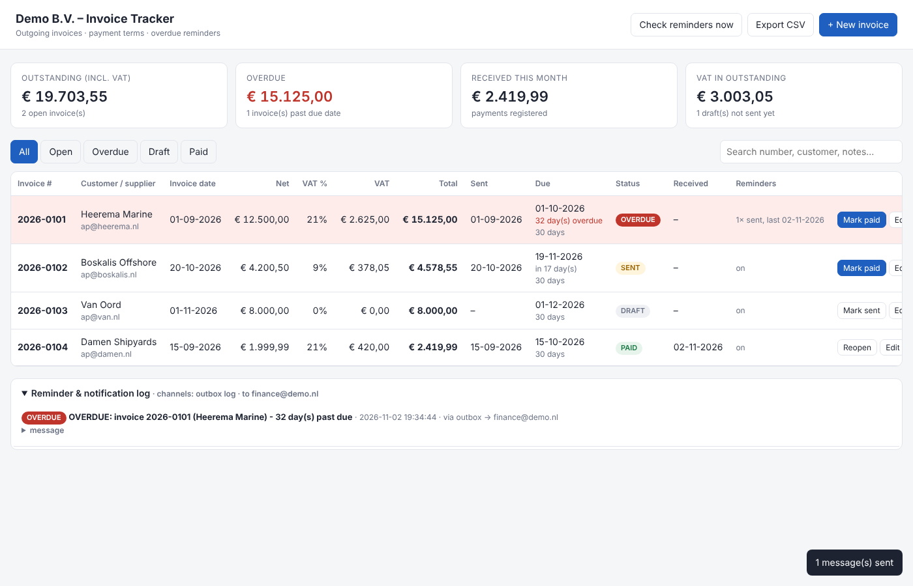

# Invoice Tracker

A small tool for tracking outgoing invoices: amounts and VAT (BTW), when each invoice was sent, when it is due (30-day payment terms by default), whether the money has arrived, and a message when the due date has passed.



* **No installation.** It needs only Python 3.9+ and uses the standard library and SQLite, which is a single `invoices.db` file.
* **Web interface** in the browser: overview cards, filters (Open / Overdue / Draft / Paid), search, and CSV export for Excel.
* **Reminder job** that runs in the background inside the server. It can also run once a day from cron or Windows Task Scheduler.

## Features

| Requirement | How it works |
|---|---|
| Invoice date, net amount, VAT %, amount after tax | VAT and the gross amount are calculated automatically, rounded half-up to the cent. Choose 21 %, 9 % or 0 % (zero rate, reverse charge, exempt), or enter another rate. Amounts accept Dutch input such as `1.234,56` and `8.000`. |
| Date sent to the customer | The *Date sent* field, or the **Mark sent** button (sets today). |
| Due date (30-day payment terms) | Due date = sent date + payment terms. The terms default to 30 days and can be changed per invoice. You can also override the due date by hand. |
| Status when the amount is received | Statuses are `DRAFT` → `SENT` → `PAID`. **Mark paid** records the date the payment was received; the invoice is then fully settled. **Reopen** undoes it. `OVERDUE` is shown automatically for a sent, unpaid invoice whose due date has passed. |
| Reminder | An optional personal reminder date per invoice sends one message on that date. |
| Message when the due date is breached | The first message goes out the day after the due date. It repeats every `repeat_every_days` (default 7) until the invoice is marked paid. It can be switched off per invoice. If you change the due date, the reminder cycle restarts. Duplicates are never sent. |

Messages go to the **internal finance recipients** (`notify_to`). They can also go to the customer's contact e-mail (`send_to_customer = true`), by:

* **E-mail** over SMTP, for example Microsoft 365 (`smtp.office365.com:587`)
* A **Microsoft Teams or Slack** incoming webhook
* **Always:** an entry in `outbox.log` and in the log panel of the web interface, so nothing is lost if e-mail is not set up yet

## Quick start

```bash
cd Invoice-tracker
```

```bash
cp config.example.ini config.ini
```

Edit `config.ini` to set the company name, recipients and SMTP. Then start the server:

```bash
python invoice_tracker.py serve
```

Open <http://127.0.0.1:8080>.

## Scheduling the reminder check (optional)

While `serve` is running, the reminder job runs every hour (`reminder_check_interval_minutes`). If the server is not always running, schedule the job once a day instead:

**Linux / macOS (cron), every day at 08:00:**

```bash
0 8 * * * cd /path/to/Invoice-tracker && python3 invoice_tracker.py check-reminders
```

**Windows Task Scheduler:** create a daily task with
Program `python.exe`, arguments `invoice_tracker.py check-reminders`, and *Start in* set to the folder.

The command exits with code 1 if a message could not be delivered, so the scheduler can flag it.

## Configuration (`config.ini`)

See [`config.example.ini`](config.example.ini). The most important settings:

| Section / key | Default | Meaning |
|---|---|---|
| `app.default_payment_terms_days` | 30 | Payment terms for new invoices |
| `app.default_vat_rate` | 21 | Default VAT % |
| `reminders.repeat_every_days` | 7 | Repeat interval for overdue messages |
| `reminders.notify_to` | – | Internal recipients, comma-separated |
| `reminders.send_to_customer` | false | Also e-mail the customer's contact |
| `smtp.*` | – | Mail server. Leave `host` empty to disable e-mail. |
| `webhook.url` | – | Teams or Slack webhook |

`config.ini`, the database and `outbox.log` are git-ignored.

## HTTP API

The web interface uses a small JSON API, which you can also call from scripts:

| Method | Path | Purpose |
|---|---|---|
| GET | `/api/invoices?status=OPEN\|OVERDUE\|DRAFT\|SENT\|PAID&q=text` | List invoices |
| POST | `/api/invoices` | Create (`invoice_number`, `customer`, `invoice_date`, `net_amount`, `vat_rate`, …) |
| PUT | `/api/invoices/{id}` | Update (partial update is allowed) |
| DELETE | `/api/invoices/{id}` | Delete |
| POST | `/api/invoices/{id}/sent` | Mark as sent (`sent_date`, default today) |
| POST | `/api/invoices/{id}/paid` | Mark as paid (`paid_date`, default today) |
| POST | `/api/invoices/{id}/reopen` | Set a paid invoice back to open |
| GET | `/api/summary` | Totals: outstanding, overdue, received this month |
| POST | `/api/reminders/run` | Run the reminder job now |
| GET | `/api/notifications` | Message log |
| GET | `/api/export.csv` | CSV export (`;` separator and decimal comma, for Dutch Excel) |

## Tests

```bash
python -m unittest test_invoice_tracker -v
```

## Security and next steps

* By default the server listens only on `127.0.0.1`, so only the local PC can reach it. It has **no login**. To share it on the office network, put it behind a reverse proxy with authentication (IIS, nginx, or an Azure App Proxy) rather than just setting `host = 0.0.0.0`.
* Back up `invoices.db` regularly. It is one file, so copying it is enough. Dutch tax law requires invoice records to be kept for 7 years.
* Possible extensions: link to the SAP FI open items (FBL5N, `BSID`/`BSAD`) to mark payments automatically, a PDF attachment per invoice, and statutory commercial interest (wettelijke handelsrente) on overdue amounts.
